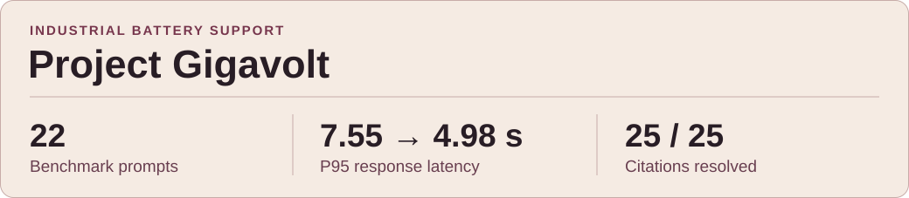

# Harshil Prashant Shah

**MS in Management Information Systems, Texas A&M University · Mays Business School · Class of 2028**

I work on data systems, from checking why reports disagree to building tools that show where an answer came from. I studied Information Technology with Honours in DevOps at D. J. Sanghvi College of Engineering before moving from Mumbai to Texas A&M.

## Featured project

Gigavolt brings together service records, IoT telemetry, and technical manuals on AWS so a field engineer can ask a question and check the original record or passage. On the same 22-prompt EC2 workload, sequential throughput rose from **0.363 to 0.780 requests/s**. The citation audit matched all 25 emitted references to saved evidence.

[Repository and architecture](https://github.com/harshilshah250504/Project-Gigavolt) · [Benchmark and provenance](https://github.com/harshilshah250504/Project-Gigavolt#benchmark-and-provenance) · [Portfolio case study](https://harshil-prashant-shah.vercel.app/#gigavolt)

## Experience

- **Texas A&M University · Teaching Assistant.** Support students in ISTM 209, Business Information Systems.
- **Innoquad Technologies · Project Management Intern.** Coordinated three industrial IoT initiatives across hardware, software, and QA teams, tracking schedules, budgets, and dependencies.
- **Engaze · Data Analyst Intern.** Built reports and dashboards with Python and SQL, automated ETL checks, and investigated discrepancies in operational reporting.

I also chaired a 100+ member Computer Society of India student chapter at D. J. Sanghvi, where I helped organize technical events and industry collaborations.

## Research and selected projects

| Project | What I worked on | Research |
| --- | --- | --- |
| [AQInsight](https://github.com/harshilshah250504/FYP) | Air-quality exploration with weather, traffic, and wildfire data. Includes a web app and Python research notebook. | [Manuscript](https://drive.google.com/file/d/1jRA-Yd8acJ9VW4yiHOxIWP4FD1hm4xkA/view) |
| [Multilingual Phishing Detection](https://github.com/harshilshah250504/phishing-email-detection) | English and Hindi email classification with XGBoost and SHAP. | [IEEE Xplore](https://ieeexplore.ieee.org/document/11566454) |
| [Statistical Test Prediction](https://github.com/harshilshah250504/statistical-test-prediction) | Natural-language recommendations and calculation workflows for non-parametric tests. | [Springer](https://link.springer.com/chapter/10.1007/978-3-032-12990-1_27) |
| [FinWizard](https://github.com/harshilshah250504/finwizard) | Stock-market prediction experiments using historical prices, news sentiment, and deep learning. | [Taylor &amp; Francis](https://www.taylorfrancis.com/chapters/edit/10.1201/9781003773504-127/stock-market-prediction-using-news-api-deep-learning-algorithms-harshil-shah-dhvani-shah-dharmil-parekh-janhavi-patel-richa-sharma) |

## Tech stack

**Languages and tooling**

**Databases and pipelines**

**Cloud and deployment**

**AI and retrieval**

**Machine learning and statistics**

**Analytics and visualization**

**Web applications**

## GitHub activity

